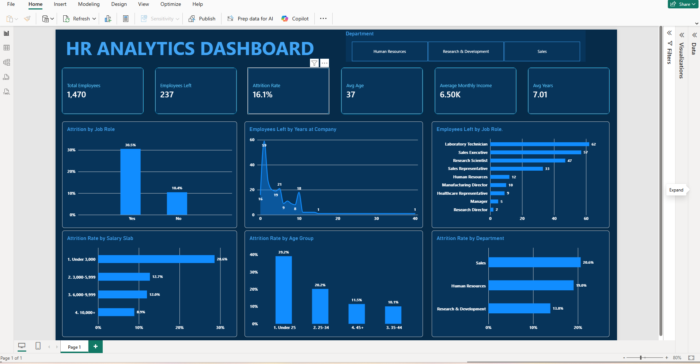

# HR Employee Attrition Analysis (MySQL + Excel + Power BI)

An end-to-end analysis of employee attrition for a company of 1,470 employees. The project looks at who leaves, in which departments and roles, and how factors such as overtime, income, age and job satisfaction relate to attrition.

---

## 1. Business Problem

A company is losing employees and wants to know:

1. What is the overall attrition rate?
2. Which departments, job roles and age groups lose the most people?
3. How do overtime, income, job satisfaction and promotion history relate to leaving?
4. What can HR do to keep people?

---

## 2. Dataset

- Source: [IBM HR Analytics Employee Attrition & Performance (Kaggle)](https://www.kaggle.com/datasets/pavansubhasht/ibm-hr-analytics-attrition-dataset)
- 1,470 employees, 35 columns
- **This is a fictional data set created by IBM data scientists**, so the findings describe this dataset, not a real company.
- Key columns: Attrition, Age, Department, JobRole, MonthlyIncome, OverTime, JobSatisfaction, YearsAtCompany, YearsSinceLastPromotion, Gender
- The raw CSV is not stored in this repo (see the Kaggle link above)

---

## 3. Tools

| Tool | Used for |
|------|----------|
| MySQL 8 | Creating the table, loading the CSV, writing analysis queries (GROUP BY, CASE, CTE, window functions) |
| Excel | Pivot tables, charts and a department slicer |
| Power BI | Interactive dashboard with KPI cards, DAX measures and slicers |

---

## 4. Project Workflow

1. Downloaded the dataset from Kaggle
2. Created a MySQL database and table, then loaded the CSV with `LOAD DATA LOCAL INFILE`
3. Wrote 12 SQL queries to answer the business questions
4. Exported a clean dataset with age groups, income bands and an attrition flag
5. Built pivot tables and charts in Excel
6. Built a Power BI dashboard with DAX measures

---

## 5. Repository Structure

```
hr-attrition-analysis/
├── README.md
├── sql/
│   └── hr_attrition_project.sql
├── excel/
│   └── hr_analysis.xlsx
├── powerbi/
│   └── hr_dashboard.pbix
└── screenshots/
    ├── dashboard.png
    ├── attrition_by_department.png
    ├── attrition_by_overtime.png
    └── attrition_by_age_group.png
```

---

## 6. SQL Analysis

Attrition rate = employees who left / total employees x 100.

| # | Question | Techniques |
|---|----------|------------|
| Q1 | Overall KPIs | Aggregation |
| Q2 | Attrition by department | GROUP BY, CASE |
| Q3 | Attrition by job role | GROUP BY |
| Q4 | Attrition by age group | CASE |
| Q5 | Overtime vs no overtime | GROUP BY |
| Q6 | Income and tenure of stayers vs leavers | AVG |
| Q7 | Attrition by income band | CASE |
| Q8 | Attrition by years since last promotion | CASE |
| Q9 | Attrition by job satisfaction | GROUP BY |
| Q10 | Top 3 roles by attrition within each department | CTE, RANK() window function |
| Q11 | Attrition by work-life balance (bonus) | GROUP BY |
| Q12 | Attrition by distance from home (bonus) | CASE |

---

## 7. Key Metrics

| Metric | Value |
|--------|-------|
| Total employees | 1,470 |
| Employees who left | 237 |
| Attrition rate | 16.12% |
| Average monthly income | 6,503 |
| Average age | 36.9 |

---

## 8. Key Insights

1. **Overtime is the strongest signal.** Employees working overtime left at 30.53% versus 10.44% for those who do not, about 2.9 times higher. They are 28% of employees (416 of 1,470) but 54% of leavers (127 of 237).
2. **Lower pay goes with higher attrition.** In the lowest income band (under 3,000 a month), 28.61% left, compared with 8.90% in the top band (10,000+), about 3.2 times lower. The lowest band is 27% of employees but 48% of leavers (113 of 237). Leavers earned about 30% less on average than stayers (4,787 vs 6,833 a month).
3. **Younger employees leave most.** 39.18% of employees under 25 left, versus 20.22% for ages 25-34 and about 10% for ages 35-44. The 25-34 group accounts for 112 of the 237 leavers (47%). Attrition is slightly higher again for 45+ (11.46%) than for 35-44 (10.10%).
4. **Attrition is concentrated in a few roles.** Sales Representatives (39.76%), Laboratory Technicians (23.94%) and Human Resources (23.08%) are highest. Research Director (2.50%), Manager (4.90%), Healthcare Representative (6.87%) and Manufacturing Director (6.90%) are lowest. Laboratory Technicians alone are 26% of leavers (62 of 237).
5. **Sales and HR have the highest department rates.** Sales 20.63%, Human Resources 19.05% and Research & Development 13.84%. R&D is the largest department, so it has the most leavers (133 of 237, 56%).
6. **Job satisfaction matters.** Employees with the lowest satisfaction score left at 22.84%, about twice the rate of those with the highest score (11.33%).
7. **Leavers had shorter tenure.** Leavers had spent 5.1 years at the company on average, versus 7.4 years for stayers.
8. **Promotion history shows no clear pattern.** Employees promoted this year left at 18.93%, those promoted 3-5 years ago at 10.13%, and those promoted 6+ years ago at 16.28%. The data does not support a simple "longer without promotion means more attrition" story.

---

## 9. Recommendations

1. **Review overtime and workload**, especially in Sales and Laboratory Technician roles.
2. **Review pay for the lowest income band**, where nearly half of all leavers sit.
3. **Support employees under 35** with onboarding, mentoring and clear career paths.
4. **Investigate the Sales Representative and Laboratory Technician roles** (targets, workload, pay, management) since attrition is highest there.
5. **Track job satisfaction regularly** and follow up with employees who report low scores.

---

## 10. Excel Analysis

Pivot tables and charts built from the exported clean dataset (1,470 rows):

- Attrition rate by department
- Attrition rate by overtime
- Attrition rate by age group
- Department slicer connected to all pivots

(The attrition rate is the average of a 1/0 attrition flag.)


---

## 11. Power BI Dashboard

Example DAX measures:

```
Total Employees = COUNTROWS(employees)
Employees Left = CALCULATE(COUNTROWS(employees), employees[Attrition] = "Yes")
Attrition Rate = DIVIDE([Employees Left], [Total Employees])
```

The one-page dashboard has:

1. **Six KPI cards:** Total Employees (1,470), Employees Left (237), Attrition Rate (16.12%), Avg Age (37), Average Monthly Income (6.50K) and Avg Years at Company (7.01)
2. **Attrition Rate by Overtime** (30.5% vs 10.4%)
3. **Attrition Rate by Age Group**
4. **Attrition Rate by Salary Slab**
5. **Attrition Rate by Department**
6. **Employees Left by Job Role** and **Employees Left by Years at Company** (counts)
7. **Department slicer** that filters every card and chart



---

## 12. Assumptions and Limitations

- The dataset is fictional, so results show patterns in this data, not a real company.
- The patterns are associations, not proof of cause. Factors overlap: for example, younger employees and lower-paid roles are likely to be the same people, so one factor alone should not be read as the reason people leave.
- Some groups are small (for example Sales Representative has 83 employees, Human Resources 52, and employees under 25 only 97), so their percentages are less reliable.
- The data is a single snapshot, so it cannot show how attrition changes over time.

---

## 13. How to Reproduce

1. Download the dataset from Kaggle and place the CSV in a folder (for example `C:/hr/`)
2. Open `sql/hr_attrition_project.sql` in MySQL Workbench, update the file path in Part 2, and run Parts 1 and 2
3. Run the queries in Part 3
4. Run the export query in Part 4 and open the result in Excel or Power BI

---

## 14. Author

[Mir Musraf Ali] | [www.linkedin.com/in/Mir-Musraf-Ali] | [mirmusrafali35@gmail.com]
